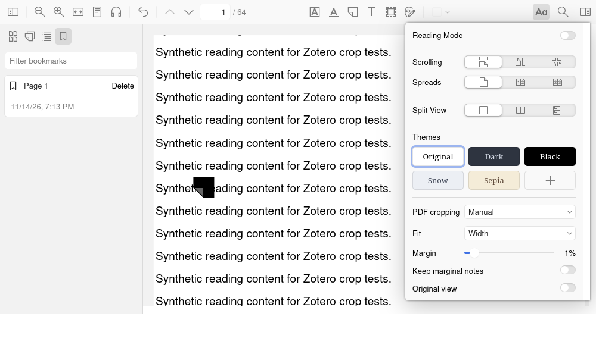

# Motero Compliments

Ein unabhängiges Plugin für Zotero Desktop: Moteros PDF-Zuschnitt und
Lesezeichen im integrierten Reader. PDF-Dateien bleiben unverändert.

## Installation

[Aktuelles XPI herunterladen](https://github.com/OptikerGerhardt/Motero-Compliments/releases/latest)
und in Zotero unter **Werkzeuge → Plugins →
Zahnrad → Plugin aus Datei installieren…** auswählen. Anschließend ein PDF öffnen.

Das Manifest erlaubt Zotero 7–10. Der tatsächliche Desktop-Teststand steht in
[docs/TESTING.md](docs/TESTING.md); andere Plattformen/Versionen sind dadurch
nicht automatisch verifiziert.

## Bedienung

- **Aa → PDF-Zuschnitt** enthält die Zuschnitt-Einstellungen direkt im nativen
  Erscheinungsbild-Menü. Es gibt keine zusätzliche Motero-Werkzeugleiste.
- **Automatisch** erkennt Textkörper, Kopf-/Fußzeilen und Marginalien mit Moteros
  Leserlogik, einschließlich Scans und lokaler Layoutanalyse. Die Option
  **Marginalien beibehalten** erhält die seitlichen Randnotizen.
- **Breite / Höhe / Ganze Seite** passt den zugeschnittenen Ausschnitt an.
  **Rand (%)** gibt bei automatischem Zuschnitt zusätzlichen Abstand.
- **Rahmen bearbeiten…** zeigt eine Vorschau mit verschiebbarem Rahmen,
  acht Griffen und Prozentfeldern. Pfeiltasten verschieben den fokussierten Rahmen,
  Umschalt vergrößert den Schritt. Der Rahmen gilt für **alle**, **ungerade** oder
  **gerade** PDF-Seiten, unabhängig von gedruckten Seitennummern. Ein neuer
  Alle-Seiten-Rahmen ersetzt die beiden Ausnahmen. Abbrechen verwirft die Bearbeitung.
- **Originalansicht** zeigt vorübergehend die vollständigen Seiten;
  gespeicherte Rahmen bleiben erhalten. **Zurücksetzen** löscht sie.
- **Oben rechts im sichtbaren PDF-Ausschnitt hovern** zeigt den Lesezeichen-Schalter.
  Ein gespeichertes Lesezeichen bleibt als kleine Motero-Flagge mit 65% Deckkraft sichtbar;
  die Klickschaltfläche erscheint erst beim Überfahren oder Tastaturfokus.
- Der **Fähnchen-Tab rechts neben Outline** öffnet die Lesezeichen in Zoteros
  Sidebar: filtern, direkt zur Seite springen und löschen. Gewöhnliche schwarze
  Notizen zählen nicht dazu. Zurück zu Outline/Annotationen/Vorschaubildern über
  deren unveränderte native Schaltflächen wechseln.

Zuschnitt und Modi werden lokal pro Bibliothek und Anhang gespeichert.
Lesezeichen sind normale Zotero-Notizannotationen mit `Bookmark ·` bzw.
`Lesezeichen ·`, kompatibel mit Motero. Vorhandene Farben bleiben erhalten;
schreibgeschützte Annotationen werden nicht verändert. Zotero übernimmt deren
normale Synchronisierung. Es werden keine PDF-Inhaltsverzeichnisse bearbeitet.

Der Desktop bereitet bis zu **12 Seiten voraus und 6 zurück** vor. Zwei Analyseaufgaben
und ein 64-Seiten-Cache begrenzen die Last; sichtbare Seiten haben Vorrang. Nativer
Reset Zoom und eigener Zoom bleiben wirksam, gespeicherte Rahmen bleiben erhalten.

## Entwicklung



Node.js 22+, npm und Python 3. Keine Laufzeit-Abhängigkeiten oder externen Dienste.

```sh
npm ci --cache /tmp/motero-npm-cache --no-audit --no-fund
npm test
npm run build
python3 scripts/test-zotero.py /absoluter/pfad/zu/zotero
```

Der letzte Befehl startet das fertige XPI in einem neuen temporären Profil mit
synthetischem PDF und eigener Datenbank. Persönliche Profile bleiben unberührt.
`dist/` ist generiert und nicht eingecheckt. Neue Versionen kommen über Zoteros
eingebaute Plugin-Updates; die veröffentlichte `update.json` bindet jede
Release-Datei an ihren SHA-256. [Release-/Update-Verfahren](docs/RELEASING.md).

[Recherche und Entscheidungen](docs/RESEARCH.md) ·
[Tests und Grenzen](docs/TESTING.md) · [Urheberhinweise](NOTICE.md) ·
[AGPLv3](COPYING)
