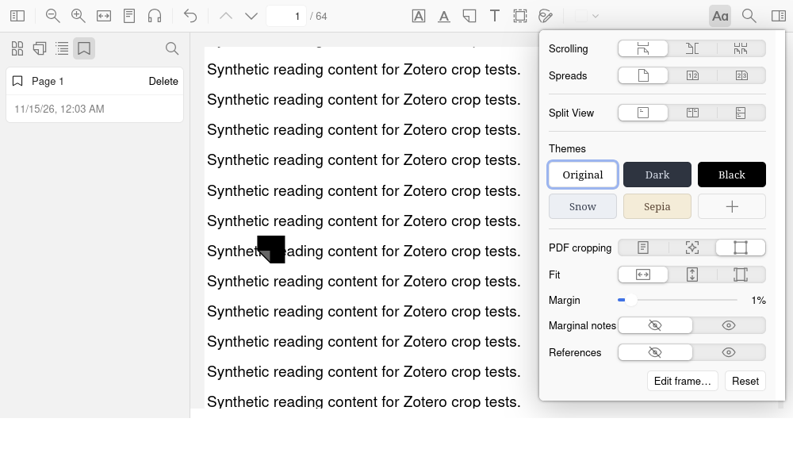

# Verifikation 0.3.0

15.11.2026, Linux x86_64, offizielles Zotero 10.0.8.

- **118 Logiktests bestanden**, keine fehlgeschlagenen oder übersprungenen Tests.
  Enthält Motero-Regressionen, Schreibschutz, native Koordinaten, Prioritätsqueue,
  begrenzte Vorverarbeitung und Diagnostik bei Raster-/Textanalysefehlern.
- **64 native Funktionstests bestanden** mit 64 synthetischen PDF-Seiten,
  eingebetteten Farbbildern, Softmasken und einer Editionsreferenz am Rand.
  [Bericht](zotero-0.3.0-linux.json).
- **13 Prüfungen mit der privat bereitgestellten PDF bestanden.** Automatisch
  entfernt auf der geprüften Seite sichtbar etwa 37,5% der Papierfläche, auch bei
  Breite/Höhe/Ganzseite und nach Original→Automatisch. Referenzoptionen lassen
  sich verlustfrei umschalten; schneller Seitenwechsel und Reset Zoom funktionieren.
  Die PDF-Bytes bleiben identisch. [Inhaltsfreier Nachweis](private-document-regression-0.3.0.json).

Die gezielt erzeugte Editionsreferenz verbreitert beim Einschließen den sichtbaren
nativen Ausschnitt und verschwindet beim Ausschließen wieder. Die geprüfte private
Seite enthält keine entsprechend erkannten Seitenreferenzen; dort erwartet der
Test einen unveränderten Rahmen nach dem Umschalten. Vier Kombinationen von
Randnotizen/Randverweisen sowie leere und getönte Seiten sind zusätzlich durch
Logiktests abgedeckt. Bei getönten Textseiten wird der tatsächlich übernommene
MIT-Detektor als Fallback geprüft.

Ein numerischer Vergleich auf der privaten Prüfseite ergibt 63,4% Restfläche für
Crop to Margins rohen `inkBox`-Detektor und 62,5% für Moteros integrierte Richtlinie
mit Rand. Das vergleicht weder komplette Plugins noch allgemeine Erkennungsqualität.
Der Fehler des veralteten Maßstabs wurde korrigiert: Pixelbeschnitt wird erst nach
dem automatischen Fit auf den aktuellen Viewport angewendet.

Die automatische Raster-/Textanalyse läuft im PDF-Fenster und gibt nur geklonte
Daten an das Plugin zurück. Das native Langdokument-Szenario prüft Vorverarbeitung
über mindestens zwölf zusätzliche Seiten, den 64-Seiten-Cache, schnelle Navigation
während der Vorbereitung und den Vorrang von Benutzerzoom. Reset Zoom wird auch
nach Speicherung eines manuellen Rahmens geprüft: Maßstab und Rahmen bleiben
unverändert erhalten. Sichtbarkeit und Seitensprünge berücksichtigen die sichtbaren
Zuschnitte, ohne PDF- oder Annotationskoordinaten umzuschreiben.

Weitere native Prüfungen: exakt gleiche Schrift wie Zoteros Labels, ausgerichtete
Appearance-Segmenttasten, 20px-Fähnchen-Tab rechts neben Outline, 65% Deckkraft,
42×54-Pixel-PDF-Flagge, Hover-/Fokus-Sichtbarkeit, native Notizen, Toolbar-Lupe/Sprung/
Löschen, wiederholte Outline-Wechsel, manuelle Rahmen, Rotation, Abbrechen,
Originalansicht und Wiederherstellung beim Deaktivieren/Reaktivieren.

Der Screenshot wurde aus dem echten Zotero-Reader erzeugt und visuell geprüft.
Von der privat bereitgestellten PDF wurden keine Screenshots angefertigt und
weder Datei, Text, Bilder noch Titel in das Repository übernommen.

## Grenzen

Windows/macOS, Zotero 7–9, andere Crop-Plugins und gleichzeitige Split-Views sind
nicht durch diese Tests abgedeckt. Konto-/Gerätesynchronisierung wurde nicht
getestet. Maus-/Touch-Hardware wurde nicht bedient; Rahmenalgorithmus,
Tastatur/Prozentfelder und berechnete Hover-Zustände wurden geprüft. Tests großer
Dateien ersetzen keine Prüfung beliebiger PDF-Layouts.

Alle nativen Prüfungen verwenden neue temporäre Profile und eigene Datenbanken.
Vorhandene System-Proxy-CAs werden ausschließlich in diese Testprofile importiert;
TLS-Prüfung bleibt aktiv. Persönliche Zotero-Profile bleiben unberührt.

## Öffentlicher Update-Test 0.2.1→0.3.0

Nach Veröffentlichung hat Zotero das unveränderte öffentliche 0.2.1-XPI über den
eingebauten Updater auf 0.3.0 aktualisiert. Feed-Erkennung, Download, Hashprüfung
und Aktivierung sowie anschließend alle **66 Prüfungen** bestanden.
[Bericht](zotero-upgrade-0.2.1-to-0.3.0.json).

Öffentlicher Feed, heruntergeladenes Release-Asset und lokal vorbereitetes Paket
haben denselben SHA-256:
`ab2d0575a37b721c5a013769b733d5aa2f0b350287cf4889e757cab559b1a803`.
Das Release wurde aus dem getesteten Merge-Commit
`a630ef2e1b3ce63d0a7c61d245b65f261b3af106` gebaut. Frühere Assets und Feed-Hashes
bleiben unverändert; dieser nachträgliche Nachweis ersetzt das Release-Paket nicht.

## Frühere Versionen

Die Berichte zu [0.2.0](zotero-10.0.8.json) und zum öffentlichen
[0.1.0→0.2.0-Update](zotero-upgrade-0.1.0-to-0.2.0.json) bleiben für die Historie erhalten.
Auch [0.2.1](zotero-0.2.1-linux.json) und dessen
[private Fehlerregression](private-document-regression-0.2.1.json) bleiben erhalten.

## Öffentlicher Update-Test 0.2.0→0.2.1

Nach Veröffentlichung hat Zotero das unveränderte öffentliche 0.2.0-XPI über den
eingebauten Updater auf 0.2.1 aktualisiert: Feed-Erkennung, Download, Hashprüfung
und Aktivierung erfolgreich. Danach bestanden alle **58 Prüfungen** einschließlich
des 64-Seiten-Szenarios, der Desktop-Vorbereitung und beider Reset-Zoom-Fälle.
[Bericht](zotero-upgrade-0.2.0-to-0.2.1.json). Das veröffentlichte Asset wurde
nicht ersetzt.
