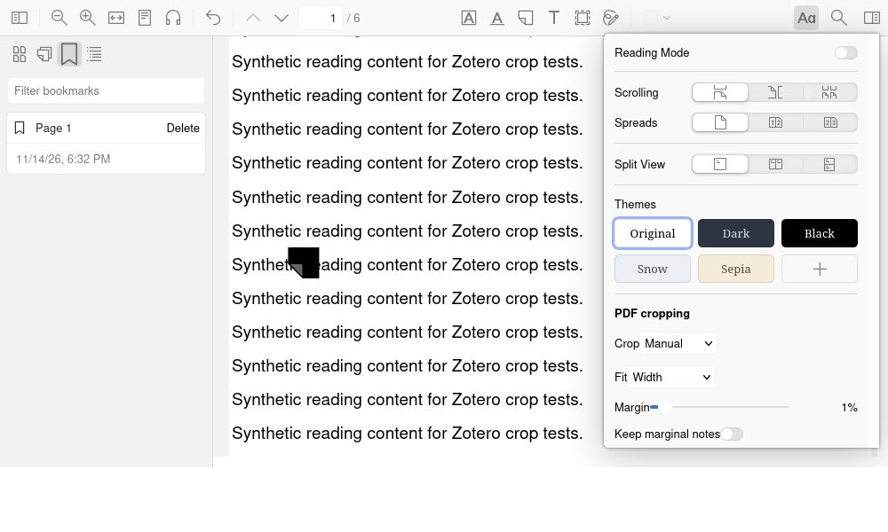

# Verifikation 0.2.0

Stand: 14.11.2026, Linux x86_64, offizielles Zotero 10.0.8.

- `npm test`: **104 bestanden**, keine fehlgeschlagenen oder übersprungenen Tests.
  Motero-Regressionsfälle für Inhaltserkennung, Scans, Kopf-/Fußzeilen,
  Randreferenzen, Fußnoten, Layoutwechsel und manuelle Rahmen; zusätzlich
  Persistenz, Koordinaten, Schreibschutz, schnelle Klickfolgen, sichere
  Callback-Benachrichtigungen und checksum-gebundene Update-Metadaten.
- `npm run build`: installierbares XPI mit AGPL-Lizenz und Originalquellen.
- Isolierter nativer Zotero-Test: **44 funktionale Prüfungen bestanden**.
  [Vollständiger Ergebnisbericht](zotero-10.0.8.json).

Der Test installiert das gepackte XPI in einem neuen Profil mit eigener
Datenbank und synthetischem PDF. Er reproduziert Firefox' abgelehnte fremde
Objektübergabe in getrennten Sicherheitskontexten und prüft den korrigierten
Benachrichtigungspfad. Automatischen Zuschnitt und den Wechsel zwischen
Ganzseiten- und Breitenanpassung durchläuft er ohne Permission-Fehler.

Geprüft werden außerdem: Zuschnitt direkt unter Aa, Fähnchen-Tab vor Outline,
Filter/Sprung/Löschen, wiederholte Rückkehr zu nativen Sidebar-Tabs,
transparente Flaggen innerhalb des Zuschnitts, tatsächlich berechnete
Hover-Sichtbarkeit, native Annotationen und Erhalt gewöhnlicher schwarzer
Notizen, präziser Rahmeneditor, Rotation, Abbrechen, Originalansicht,
Persistenz und vollständige Wiederherstellung beim Deaktivieren/Reaktivieren.
Die PDF-Bytes werden vollständig vor/nach dem Test verglichen und bleiben gleich.

Der Screenshot stammt aus dem echten Zotero-Reader; er wurde visuell geprüft.
Er zeigt das Aa-Menü und die Lesezeichen-Sidebar, keine persönlichen Dokumente.

## Grenzen

- Windows, macOS und Zotero 7–9 sind nicht durch diesen Linux-/Zotero-10-Test
  abgedeckt, auch wenn das Manifest diese Versionen zulässt.
- Synchronisierung mit einem echten Konto/Motero-Gerät wurde nicht durchgeführt.
  Lesezeichen verwenden das bestehende Motero-Format und Zoteros Speicherpfad;
  Zuschnitte bleiben lokal.
- Gleichzeitige Split-Views und andere Crop-Plugins sind nicht end-to-end geprüft.
  Maus-/Touch-Hardware wurde nicht bedient: der Rahmenalgorithmus hat
  Regressionstests, der native Editor wurde per Tastatur/Prozentfeldern und
  Hover über Firefox' Pseudoklassen-Prüfschnittstelle geprüft.
- Sehr große Bücher und beliebige reale PDF-Layouts sind nicht vollständig
  geprüft. Automatische Erkennung bleibt eine Heuristik; Originalansicht oder
  manuelle Rahmen sind für ungewöhnliche Layouts verfügbar.

Das Testprofil vertraut den bereits im Cloud-System hinterlegten Proxy-CAs.
Sie werden nur in die temporäre NSS-Datenbank importiert; TLS-Verifikation
bleibt aktiv. Persönliche Profile und Zugangsdaten werden nicht verwendet.

## Öffentlicher Update-Test nach Veröffentlichung

Zotero wurde mit dem alten XPI 0.1.0 in einem weiteren frischen Profil gestartet.
Sein eingebauter Updater fand 0.2.0 über die öffentliche `update.json`, lud das
GitHub-Release herunter, prüfte dessen Hash und aktivierte das Update. Danach
bestanden **46 funktionale Prüfungen**, einschließlich der gesamten oben
beschriebenen Reader-Prüfung. [Ergebnisbericht](zotero-upgrade-0.1.0-to-0.2.0.json).

Der öffentliche Download wurde zusätzlich unabhängig gegen den veröffentlichten
SHA-256 geprüft. GitHub Actions hat das XPI aus dem getesteten Release-Commit
reproduziert und veröffentlicht. Das bereits veröffentlichte Asset wurde für
diesen Nachweis weder neu gebaut noch ersetzt.
